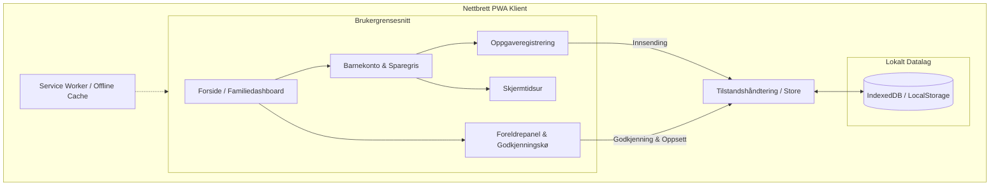

# Requirements

### Overview & Goals
Målet med applikasjonen er å maksimere barnas motivasjon for lesing, skriving og positive husholdningsoppgaver gjennom en transparent, forutsigbar og engasjerende belønningsmodell. Ved å koble innsats direkte til opptjening av skjermtid eller lommepenger, og samle dette i en personlig «barnebank», etableres sunne vaner, mestringsfølelse og god forståelse for sparing og verdi. Appen skal installeres som en PWA på familiens felles nettbrett og gi full oversikt og kontroll for foreldre gjennom PIN-beskyttede godkjenninger.

### Scope
#### In Scope
- **Familiedashboard på forsiden**: Samlet statistikk over familiens innsats (f.eks. totalt antall leste minutter, skrevne ord og utførte oppgaver) samt profilvelger for barna og tilgang til foreldremodus.
- **Barnekonto og bank (Sparegris)**: Egen profilvisning for hvert barn som viser oppspart saldo for skjermminutter og kroner, samt historikk over opptjening og uttak.
- **Aktivitetsregistrering**:
  - Dedikert registrering for lesing (tid/sider).
  - Dedikert registrering for skriving (ord/sider/fritekst).
  - Registrering av tilpassede oppgaver (husarbeid, lekser osv.).
  - Valg av belønningstype (skjermminutter, penger eller fritt valg per oppgave).
- **Foreldrepanel & Godkjenningskø**:
  - 4-sifret PIN-lås for voksenadgang.
  - Godkjenningsliste for innsendte oppgaver før belønning godskrives.
  - Administrasjon av oppgaver (opprette, redigere, slette og sette satser).
  - Mulighet for manuelle saldojusteringer.
- **Uttak av belønninger**:
  - Uttak av skjermminutter med innebygd nedtellingstimer for skjermtid.
  - Uttak/registrering av utbetalte lommepenger.
- **PWA-støtte**: Tilpasset nettbrettformat med mulighet for installasjon på hjemskjerm og offline-funksjonalitet.

#### Out of Scope
- Ekte bankintegrasjon eller overføring av faktiske penger (appen fungerer som et digitalt regnskap).
- Maskinell stavekontroll eller automatisk verifisering av lese-/skrivekvalitet (dette vurderes av foreldrene i godkjenningskøen).

---

### User Stories
- **Som barn** ønsker jeg å registrere at jeg har lest eller skrevet, slik at jeg kan tjene opp skjermtid eller penger til sparegrisen min.
- **Som barn** ønsker jeg å se min totale saldo og kunne ta ut skjermminutter når jeg skal spille, slik at jeg har full oversikt over hva jeg har gjort meg fortjent til.
- **Som forelder** ønsker jeg å se en samlet oversikt på forsiden over barnas totale innsats, slik at vi sammen kan feire fremgang og innsatsvilje.
- **Som forelder** ønsker jeg å godkjenne oppgaver og sette opp nye oppdrag med egne satser bak en sikker PIN-kode, slik at rettferdighet og nøyaktighet opprettholdes uten at barna kan manipulere saldoen.

---

### Functional Requirements
1. **Forside og Samlet Statistikk**:
   - Vise aggregert familiestatistikk: totalt leste minutter/bøker, totalt skrevne ord/sider og fullførte oppgaver denne uken/totalt.
   - Vise profilkort for hvert barn med bilde/avatar, navn og rask saldooversikt.
   - Knapp for å låse opp «Foreldremodus» med PIN-kode.
2. **Oppgaveregistrering for Barna**:
   - Enkelt og visuelt grensesnitt tilpasset touch-skjerm på nettbrett.
   - For lesing: Tast inn antall minutter eller sider lest, samt valgfri tittel på boken.
   - For skriving: Tast inn antall ord eller sider skrevet, eller skriv inn teksten direkte i appen.
   - For andre oppgaver: Velg fra listen over tilgjengelige oppdrag opprettet av foreldrene.
   - Velge belønning dersom oppgaven tillater valg (f.eks. «15 skjermminutter» ELLER «15 kroner»).
   - Innsending setter status til `Venter på godkjenning`.
3. **Foreldrepanel & Godkjenning**:
   - Innlogging via 4-sifret PIN-kode.
   - Godkjenningskø: Viser alle ventende oppgaver med tidsstempel, barnets navn, oppgavetype og foreslått belønning.
   - Forelder kan godkjenne, avvise eller justere belønningen før endelig godkjenning.
   - Oppgavebank: Legge til nye oppgaver med navn, beskrivelse, ikon og belønning (minutter, kroner eller valgfritt).
4. **Uttak og Skjermtidsur**:
   - Barnet kan be om uttak av skjermminutter eller penger fra sin profil.
   - Ved uttak av skjermtid aktiveres en visuell nedtellingstimer med alarm/varsel når tiden er ute.
   - Foreldre bekrefter uttak med PIN dersom ønskelig, og saldoen trekkes tilsvarende.

---

### Non-Functional Requirements
- **Nettbrett-optimalisert (PWA)**: Responsivt og berøringsvennlig design tilpasset horisontal og vertikal nettbrettskjerm (iPad, Android-tablets).
- **Offline-kapasitet**: All kjernefunksjonalitet fungerer lokalt på nettbrettet via Service Worker og IndexedDB/LocalStorage, slik at registrering aldri stopper opp ved manglende internett.
- **Brukervennlighet & Mestring**: Store knapper, tydelige fargekoder (grønn for godkjent, oransje for ventende, blå for sparebank) og visuelle fremgangsindikatorer.

# Technical Design

### Current Implementation
Prosjektet er i en ren oppstartsfase i PhpStorm (`KidsApp`). Det skal etableres en moderne frontend-arkitektur med Vue 3 eller React, TypeScript, Tailwind CSS og Vite PWA Plugin (`vite-plugin-pwa`) for optimal nettbrettopplevelse og offline-lagring.

---

### Key Decisions
1. **Frontend-stakk & PWA**:
   - **Valg**: Single Page Application (SPA) bygget med Vite + Vue 3/React og TypeScript, konfigurert med Web App Manifest og Service Worker.
   - **Begrunnelse**: Gir umiddelbar responstid, problemfri installasjon rett på nettbrettets hjemskjerm, og fjerner behovet for godkjenning i app-butikker.
2. **Lokal Lagring og Datahåndtering**:
   - **Valg**: Offline-first arkitektur med `IndexedDB` (via `idb` eller `Pinia/Zustand` med persistent lagring / `LocalStorage`).
   - **Begrunnelse**: Sikrer at appen alltid er tilgjengelig og rask på familiens nettbrett uten avhengighet til eksterne servere.
3. **Sikkerhet og Modusbytte**:
   - **Valg**: 4-sifret PIN-kode lagret som saltet hash lokalt for å skille barnevisning fra foreldreadministrasjon.
   - **Begrunnelse**: Gir tilstrekkelig beskyttelse mot at barna endrer oppgavesatser eller godkjenner egne oppgaver, samtidig som det er lynraskt for foreldre å låse opp.
4. **Godkjennings- og Saldomodell**:
   - **Valg**: Hendelsesbasert regnskapsmodell (ledger/transaksjoner). Hver godkjent oppgave eller uttak lagres som en uforanderlig transaksjonspost.
   - **Begrunnelse**: Forhindrer avrundings- og synkroniseringsfeil, og gir full sporbarhet over hvordan barna har tjent og brukt minutter og penger.

---

### Data Models / Contracts

```typescript
export type RewardType = 'screen_time' | 'money' | 'choice';

export interface ChildProfile {
  id: string;
  name: string;
  avatar: string; // F.eks. ikon-navn eller emoji
  screenTimeMinutes: number; // Nåværende saldo
  moneyBalance: number; // Nåværende saldo i NOK
  createdAt: string;
}

export interface TaskDefinition {
  id: string;
  title: string;
  category: 'reading' | 'writing' | 'chore' | 'custom';
  description?: string;
  rewardType: RewardType;
  screenTimeReward: number; // Minutter
  moneyReward: number; // NOK
  unit?: string; // F.eks. 'per 15 min', 'per side', 'per oppgave'
  icon: string;
}

export type SubmissionStatus = 'pending' | 'approved' | 'rejected';

export interface TaskSubmission {
  id: string;
  childId: string;
  taskId: string;
  category: 'reading' | 'writing' | 'chore' | 'custom';
  customTitle?: string;
  quantity: number; // Antall minutter, sider, ord eller enheter
  unitLabel: string;
  chosenRewardType: 'screen_time' | 'money';
  calculatedReward: number; // Beregnet minutter eller kroner
  status: SubmissionStatus;
  submittedAt: string;
  approvedAt?: string;
  rejectionReason?: string;
}

export interface Transaction {
  id: string;
  childId: string;
  type: 'earn' | 'withdraw';
  rewardType: 'screen_time' | 'money';
  amount: number;
  description: string;
  timestamp: string;
  submissionId?: string;
}

export interface FamilyStats {
  totalReadingMinutes: number;
  totalWritingWords: number;
  totalTasksCompleted: number;
  weeklyTrend: {
    day: string;
    readingMinutes: number;
    writingWords: number;
  }[];
}
```

---

### Components
- **`DashboardView`**: Hovedskjermen som viser familiens samlede fremgang, ukentlig statistikk, profilkort for barna og knapp til foreldremodus.
- **`ChildProfileView`**: Barnets personlige visning med visuell sparegris/bank, saldo i minutter og kroner, samt historikk og snarveier til registrering og uttak.
- **`TaskSubmissionModal`**: Berøringsvennlig veiviser for registrering av leseøkter, skriveøkter eller fullførte oppgaver med automatisk belønningskalkulator.
- **`ParentAdminView`**: PIN-låst kontrollpanel som inneholder:
  - *Godkjenningskø (`ApprovalQueue`)*: Liste over ventende oppgaver med knapp for godkjenn/avvis/juster.
  - *Oppgavebehandling (`TaskManager`)*: Opprette og konfigurere nye oppdrag og satser.
  - *Barneprofiler (`ProfileManager`)*: Legge til nye barn og justere eksisterende saldo.
- **`ScreenTimeTimerModal`**: Stor visuell nedtellingstimer med start/pause/stopp som barnet og foreldre kan starte når skjermtiden tas ut.

---

### Architecture Diagram



---

### File Structure
```text
KidsApp/
├── index.html
├── manifest.webmanifest
├── package.json
├── tsconfig.json
├── vite.config.ts
├── public/
│   ├── icons/
│   └── favicon.ico
└── src/
    ├── main.ts
    ├── App.vue / App.tsx
    ├── assets/
    │   └── styles.css
    ├── types/
    │   └── index.ts
    ├── services/
    │   ├── storageService.ts
    │   ├── authService.ts
    │   └── statsService.ts
    ├── store/
    │   └── useFamilyStore.ts
    └── components/
        ├── common/
        │   ├── PinModal.vue
        │   ├── RewardBadge.vue
        │   └── AvatarPicker.vue
        ├── dashboard/
        │   ├── FamilyStatsCard.vue
        │   └── ChildCard.vue
        ├── child/
        │   ├── BankBalance.vue
        │   ├── TransactionHistory.vue
        │   ├── TaskSubmissionModal.vue
        │   └── ScreenTimerModal.vue
        └── parent/
            ├── ApprovalQueue.vue
            ├── TaskEditor.vue
            └── ProfileEditor.vue
```

---

### Risks
- **Barn kan forsøke å gjette PIN**:
  - *Mitigering*: Innføre progressiv forsinkelse etter 3 feilede PIN-forsøk og mulighet for foreldre å enkelt endre PIN i innstillingene.
- **Datatap ved tømming av nettleserdata**:
  - *Mitigering*: Implementere enkel eksport/import av familiens data til en JSON-fil (backup) direkte fra foreldrepanelet.

# Testing

### Validation Approach
Valideringen skal sikre at familiens data flyter korrekt fra registrering via foreldregodkjenning til oppdatert saldo og uttak, samt at nettbrettvisning og PWA-funksjonalitet fungerer sømløst.

---

### Key Scenarios
1. **Lese- og skrive registrering**:
   - Barnet velger sin profil på forsiden.
   - Barnet registrerer 30 minutter lesing og velger skjermtid som belønning.
   - Oppgaven vises som «Venter på godkjenning» i barnets historikk uten at saldoen øker umiddelbart.
2. **Foreldregodkjenning**:
   - Forelder åpner foreldremodus, taster riktig PIN-kode (f.eks. `1234`), og navigerer til godkjenningskøen.
   - Forelder godkjenner leseøkten.
   - Barnets saldo oppdateres umiddelbart med de opptjente skjermminuttene.
3. **Opprettelse av ny oppgave med valgfri belønning**:
   - Forelder oppretter oppgaven «Rydde rommet» med belønning «20 minutter skjermtid ELLER 20 kroner».
   - Barnet åpner oppgaven, velger «20 kroner» og sender inn for godkjenning.
   - Ved godkjenning øker penge-saldoen med 20 kr.
4. **Uttak av skjermtid med nedtellingsur**:
   - Barnet ber om uttak av 15 skjermminutter.
   - Saldoen reduseres med 15 minutter, og nedtellingstimeren starter og teller ned fra 15:00 med pause/stopp-mulighet.
5. **Familiedashboard / Samlet statistikk**:
   - Forsiden oppdateres automatisk og summerer opp all fullført lesing, skriving og oppgaver på tvers av alle barna.

---

### Edge Cases
- **Feil PIN-kode**: Verifisere at tilgang til foreldremodus nektes og at det gis tydelig feilmelding uten å låse ute legitime brukere permanent.
- **Uttak overstigende saldo**: Verifisere at barnet ikke kan ta ut flere minutter eller kroner enn det som faktisk er tilgjengelig i banken.
- **Offline-bruk**: Koble fra nett og verifisere at registreringer, godkjenninger og saldovisning fungerer uhindret lokalt.

# Delivery Steps

### ✓ Step 1: Oppsett av PWA-grunnmur, datamodeller og lagringslag
Applikasjonsprosjektet er initiert med PWA-konfigurasjon, TypeScript, lagringsarkitektur og kjerne-datatyper.

- Konfigurer Vite med Vue 3/React, TypeScript og Tailwind CSS tilpasset nettbrettvisning (touch-vennlig layout).
- Opprett PWA-manifest (`manifest.webmanifest`) og service worker for installasjon på nettbrettets hjemskjerm og offline-støtte.
- Implementer lagringslag i IndexedDB/LocalStorage for profiler, oppgaver, transaksjoner og PIN-innstillinger.
- Etabler TypeScript-grensesnitt og standard mockdata for umiddelbar demonstrasjon og testing.

### ✓ Step 2: Familiedashboard, profilkort og barnebank
Forsiden viser familiens samlede fremgang og gir tilgang til barnas profiler med visning av opptjent saldo.

- Implementer `DashboardView` med samlet familiestatistikk (totalt leste minutter/sider, skrevne ord/sider og fullførte oppgaver).
- Bygg profilkort for hvert barn med navn, avatar og snarvei til egen side.
- Utvikle `ChildProfileView` med barnebank som visualiserer saldo for både skjermminutter og lommepenger (kroner).
- Lag en visuell transaksjons- og sparehistorikk som viser opptjente og utbetalte belønninger.

### ✓ Step 3: Oppgaveregistrering for lesing, skriving og oppdrag
Barna kan enkelt logge lese- og skriveøkter samt velge mellom forhåndsdefinerte oppgaver og ønsket belønningstype.

- Bygg `TaskSubmissionModal` med et barnevennlig, intuitivt grensesnitt for registrering av lesing (minutter/sider) og skriving (ord/sider/tekst).
- Implementer oppgavevelger for husarbeid og andre tilpassede oppgaver lagt inn av foreldrene.
- Legg til valg av belønningstype der oppgaven tillater det: valg mellom skjermminutter eller penger.
- Lagre innsendte aktiviteter med status `pending_approval` og gi visuell bekreftelse til barnet.

### ✓ Step 4: Foreldrepanel med PIN, godkjenningskø og oppgavekonfigurasjon
Foreldre kan logge inn med PIN-kode, administrere oppgaver og belønninger, samt godkjenne barnas innsendte aktiviteter.

- Implementer PIN-beskyttet `ParentAuthModal` og adgangskontroll for voksenmodusen.
- Bygg `ApprovalQueueView` der foreldre kan se ventende oppgaver, justere belønning ved behov, og godkjenne eller avvise med tilbakemelding.
- Opprett `TaskManagerView` for opprettelse, redigering og sletting av oppgaver med konfigurasjon av belønninger (skjermtid, penger, eller valgfritt).
- Håndter automatisk saldooppdatering i barnets bank ved godkjenning.

### ✓ Step 5: Uttaksmodul for skjermtid og lommepenger med nedtellingsur
Barna kan ta ut oppspart skjermtid eller penger, komplett med et aktivt nedtellingsur for skjermbruk.

- Utvikle `WithdrawalModal` der barnet velger antall minutter eller kroner de ønsker å ta ut fra sin oppsparte saldo.
- Knytt uttaket til foreldrebekreftelse eller PIN for å sikre at skjermtid og penger deles ut etter avtale.
- Implementer `ScreenTimeTimerModal` med et fargerikt nedtellingsur og pause/stopp-funksjon når skjermtid benyttes.
- Loggfør alle uttak som separate transaksjoner i barnets historikk og oppdater totalsaldoen.